<p align="center">
  
</p>

<p align="center">
  <a href="https://rraj78502.github.io"><b>portfolio</b></a> ·
  <a href="mailto:rraj78502@gmail.com"><b>email</b></a> ·
  <a href="https://github.com/rabi61743"><b>second account</b></a>
</p>

I write the software that keeps parts of **Nepal Telecom** running, and I teach engineers how to build with AI.

My days are split between Go services that handle complaints and field dispatch for a national operator, AI assistants that answer from company knowledge rather than guesswork, and commerce platforms built from the database up to the phone in your hand.

```yaml
now:
  building:  [UTS ticketing platform, LPS Digital Nexus]
  running:   multi-node Kubernetes for internal services
  teaching:  [AI Agents in Practice, AI Engineer with PyTorch]
shipped:     [NTC support chatbot, GtradeA web + mobile, fashion AI storefront, Balen tender explorer]
open_to:     conversations about Go, RAG, agents, vector search, Supabase, Kubernetes
```

### Selected work

<table>
<tr>
<td width="50%" valign="top">

**UTS: Unified Ticketing System**<br>
<sub>Nepal Telecom</sub>

Complaints and faults, from first report to a field crew. OTP sign-in, live dispatch, bulk SMS, audit trails and reporting, built as event-driven services.

<sub><code>Go</code> <code>Kafka</code> <code>gRPC</code> <code>Centrifugo</code> <code>Vault</code> <code>Grafana</code></sub>

</td>
<td width="50%" valign="top">

**LPS Digital Nexus**<br>
<sub>Enterprise platform</sub>

Automates Lightning Protection System engineering projects, from design to hand-over.

<sub><code>Go</code> <code>gRPC</code> <code>React</code> <code>PostgreSQL</code></sub>

</td>
</tr>
<tr>
<td valign="top">

**NTC Support Assistant**<br>
<sub>AI · retrieval-augmented generation</sub>

Answers customer questions from a knowledge base that refreshes itself, so replies stay current without retraining.

<sub><code>RAG</code> <code>LangChain</code> <code>vector DB</code> <code>Python</code></sub>

</td>
<td valign="top">

**GtradeA**<br>
<sub>Cross-border commerce</sub>

Imports from 1688/Alibaba priced for Nepal (HS codes, fees, FX), eSewa checkout, an offline-ready PWA and a Flutter app.

<sub><code>React</code> <code>Supabase</code> <code>Flutter</code> <code>Riverpod</code></sub>

</td>
</tr>
<tr>
<td valign="top">

**Fashion AI Storefront**<br>
<sub>Semantic commerce</sub>

Search that understands "something for a winter wedding": 768-dimension embeddings, HNSW indexing and outfit pairing.

<sub><code>Next.js</code> <code>Go</code> <code>pgvector</code> <code>Docker</code></sub>

</td>
<td valign="top">

**Balen**<br>
<sub>Civic data</sub>

Scrapes Nepal's e-GP tenders into searchable bids and maps them from province down to municipality.

<sub><code>Vite</code> <code>Supabase</code> <code>maps</code> <code>scraping</code></sub>

</td>
</tr>
</table>

<sub>Most of this is commercial or internal work, so the source stays private.</sub>

### Toolbox

| Layer | What I reach for |
|---|---|
| **Services** | Go, Python (Django, Flask), Kafka, gRPC |
| **Data** | PostgreSQL, pgvector, Supabase |
| **Interfaces** | React, Next.js, TypeScript, Tailwind, Flutter |
| **AI** | PyTorch, TensorFlow, LangChain, Ollama, RAG, agents, MCP |
| **Operations** | Kubernetes, Docker, Vault, Grafana, GitHub Actions |

### Teaching

**AI Agents in Practice:** 40 days, one project per stretch. Reasoning agents, MCP, vector databases and RAG on a local LangChain + Ollama stack.<br>
**AI Engineer with PyTorch:** from tensors and autograd to training loops, for engineers moving into deep learning.

### Activity

<sub>My commits are split across two accounts, and most of them land in private repositories, so these cards show only part of the picture.</sub>

<table>
<tr>
<th>rraj78502</th>
<th>rabi61743</th>
</tr>
<tr>
<td align="center"></td>
<td align="center"></td>
</tr>
<tr>
<td align="center"></td>
<td align="center"></td>
</tr>
</table>

<p align="center">
  
</p>
